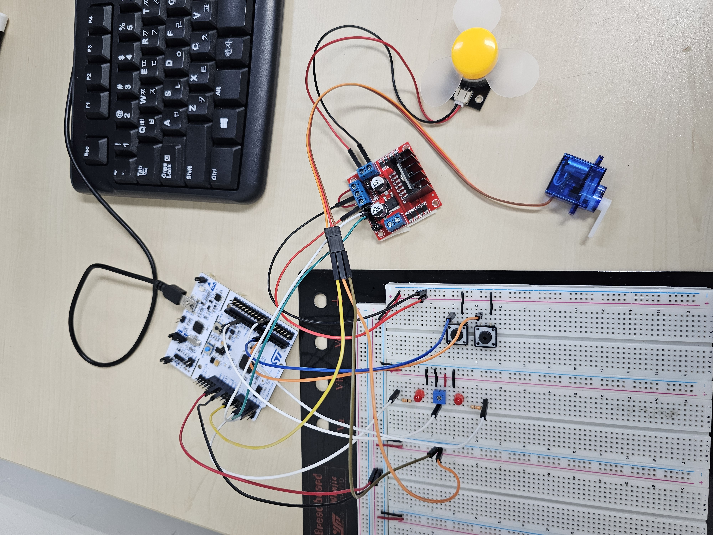
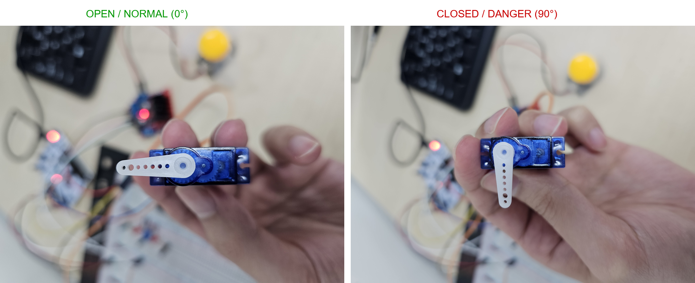

# 하드웨어와 핀맵

[문서 안내](README.md) · [펌웨어](04_firmware_driver_guide.md) · [실행 방법](08_setup_and_operation_guide.md)

## 시연 장치

STM32F411RE Nucleo에 가변저항, 버튼 2개, LED 2개, 서보, 모터 드라이버와 DC 팬을 연결합니다. 가변저항은 가스 센서 입력을, 서보 혼의 0°/90° 회전은 밸브 개폐를 표현합니다.

| 부품 | 역할 |
| --- | --- |
| STM32F411RE Nucleo | ADC·GPIO·UART·PWM 제어 |
| 가변저항 | 입력 전압 조절 |
| SG90 서보 | 밸브 개방·차단 위치 표현 |
| 모터 드라이버 + DC 팬 | 환기 동작 표현. 코드 주석상 L298N |
| LED 2개 / 버튼 2개 | 경보 표시 / 현장 차단·복구 |

## 핀맵

현재 코드의 MCU 포트 이름 기준입니다. 커넥터의 물리 번호는 실제 보드 revision·실크와 대조합니다.

| 핀 | 설정 | 연결·기능 |
| --- | --- | --- |
| PA0 | AF1 | TIM2_CH1, 서보 50Hz PWM |
| PA2 / PA3 | AF7, pull-up | USART2 TX / RX |
| PA6 | Analog | ADC1_IN6, 가변저항 출력 |
| PB0 / PB1 | Output, push-pull | LED 1 / 2 |
| PB4 / PB5 | Input, pull-up | 차단 / 복구 버튼, Active-Low |
| PC0 / PC1 | Output, push-pull | 모터 드라이버 IN1 / IN2 |

시작 코드는 PA13·PA14의 디버그 핀 설정을 잠급니다. 애플리케이션 입출력에는 사용하지 않습니다.

## 입력과 출력

가변저항 양단은 3.3V·GND, 조절 단자는 PA6에 연결합니다. 측정값은 12비트 ADC 원시값 `0~4095`이며 가스 농도 변환식은 없습니다.

| 요청 | 서보 목표 / high 폭 | PC0 / PC1 | PB0 / PB1 |
| --- | --- | --- | --- |
| 복구 `'0'` | 0° / 500µs | LOW / LOW | LOW / LOW |
| 차단 `'1'` | 90° / 1500µs | HIGH / LOW | HIGH / HIGH |

서보 펄스 폭은 타이머 설정에서 계산한 값입니다. 팬은 정회전·정지만 제어하며 IN1·IN2가 LOW일 때의 전기적 상태는 드라이버 enable 배선과 함께 확인합니다.

기존 배선 기록의 LED 직렬 저항은 각각 220Ω입니다. 전원 3.3V·LED 순방향 전압 2.0V 가정 시 전류는 약 5.9mA이며 실제 부품 사양과 대조합니다.

## 전원과 노이즈

기존 개발 기록은 구동부를 켰을 때 ADC값이 달라지는 현상과 함께 서보 측 470µF·모터 드라이버 측 100µF 캐패시터, 공통 접지 배선을 대책으로 제시했습니다.

재현 시에는 **PA6 입력·VDDA/VREF·GND의 상대 전위**를 함께 측정합니다. 최종 전원 회로도와 전후 파형이 없으므로 부품 배치나 개선 효과를 확정하지 않습니다.

연결은 전원을 끈 상태에서 대조하고, LED·버튼 → 서보 → 팬 순으로 확인합니다. 서보의 간섭 여부와 구동 전후 ADC 변화를 확인한 뒤 함께 동작시킵니다.

→ [ADC 변화에 대한 판단](07_troubleshooting_log.md#2-전원과-계측-adc-변화의-원인-분리)

## 근거

[ADC](../stm32-firmware/adc.c) · [UART](../stm32-firmware/uart.c) · [서보](../stm32-firmware/servo.c) · [LED](../stm32-firmware/led.c) · [팬](../stm32-firmware/motor.c) · [버튼](../stm32-firmware/key.c)

MCU 사양과 레지스터는 [STM32F411RE](https://www.st.com/en/microcontrollers-microprocessors/stm32f411re.html), [RM0383](https://www.st.com/resource/en/reference_manual/rm0383-stm32f411xce-advanced-armbased-32bit-mcus-stmicroelectronics.pdf)을 참고합니다.
